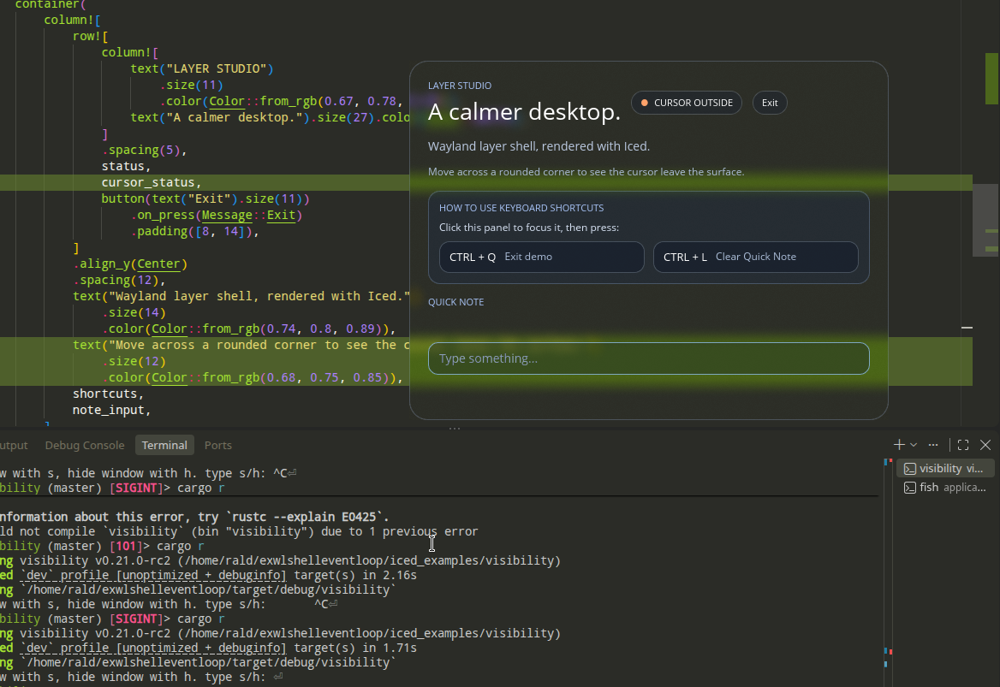

# Layer-shell visibility

This example demonstrates an Iced layer-shell panel with transparent styling,
blur, text input, and show/hide controls.

Blur is requested through the `ext-background-effect` protocol; visible blur
depends on compositor support.

Type `s` or `h` in the terminal to show or hide the panel. Hiding moves the
surface to the background layer, clears its input region, and disables keyboard
interactivity. Showing restores the surface to the top layer and restores its
rounded input region and keyboard interactivity.

Click the panel to focus it, then press `Ctrl+Q` to exit or `Ctrl+L` to clear
the Quick Note field. Plain-text clipboard copy and paste are available in the
text input.
